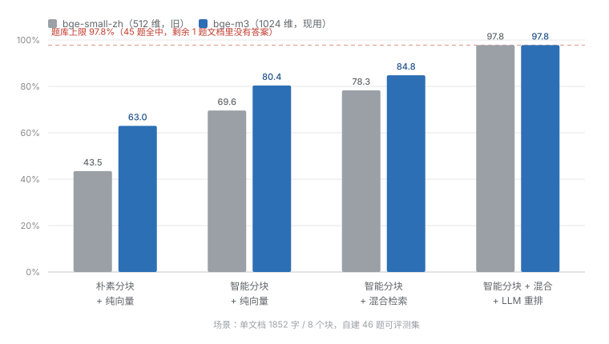

# 企业知识库问答系统（RAG）

一个不依赖向量数据库、可自动降级的检索增强生成（RAG）问答系统。
支持 `txt / md / pdf` 文档入库，检索链路为 **BM25 + 向量双路召回 → RRF 融合 → LLM 重排**，
自带 50 题评测集与消融实验脚本。

**核心结论：在自建 46 题可评测集上，Top-1 命中率从 63.0%（朴素分块 + 纯向量）提升到 97.8%（智能分块 + 混合检索 + 重排），平均命中名次从 8.00 降到 1.02。换成更弱的 `bge-small-zh` 后端时，这条曲线是 43.5% → 97.8%，两组数字都可复现。**

> 这个数字的前提是「单文档、8 个块」的小规模场景，详见下方 [已知局限](#七已知局限)。不要脱离前提引用。

---

## 一、为什么做这个

企业知识库问答的难点不在"调通一个大模型接口"，而在**把正确的资料片段送到模型面前**。
送错了，模型再强也只能编；送对了，小模型也能答准。

所以这个项目 80% 的工程量花在检索侧，而不是生成侧。整个项目围绕一个问题推进：

> 用户问「保修期多久」，我怎么能保证含答案的那一段一定排在第一？

每一层优化都对应一次可测量的指标提升，这也是这个项目里唯一值钱的部分。

---

## 二、架构

### 建库（离线，一次）

```
文档 txt / md / pdf
      │
      ▼
  按标题切节（不跨章节）
      │
      ▼
  节内按段落贪心打包，单块 ≤ 400 字
      │
      ▼
  每块前置「【章节名】」做上下文增强
      │
      ├──▶ BGE 向量化 ──▶ vectors.npy
      └──▶ 原文 ───────▶ meta.json
```

### 查询（在线）

```
用户问题
      │
      ├──▶ BGE 向量检索 ──┐
      │   （加官方 query 前缀） │
      │                    ├──▶ RRF 融合 ──▶ 候选 10 块
      └──▶ BM25 关键词检索 ┘        │
                                    ▼
                            LLM 重排（输出完整排序）
                                    │
                                    ▼
                              Top-4 拼 Prompt
                                    │
                                    ▼
                          DeepSeek 流式生成 + 引用标注
```

**关键设计：两路召回各自取 10 个候选，RRF 融合后再由重排器压到 4 个。**
粗筛求"不漏"，精排求"排对"，两个阶段的目标不同，所以用两套机制。

### 服务层（对外提供）

```
                  ┌──────────────────────┐
                  │   Streamlit 界面      │  app.py
                  │   上传 / 对话 / 引用   │
                  └──────────┬───────────┘
                             │
┌────────────────────────────┴────────────────────────────┐
│  FastAPI 服务  api.py                                    │
│  /search   只检索不生成（调试用）                          │
│  /chat     固定 RAG，非流式                               │
│  /chat/stream   固定 RAG，SSE 流式                        │
│  /agent/stream  Agentic RAG，模型自主调用工具，SSE         │
│  /health  /stats  /documents                            │
└────────────────────────────┬────────────────────────────┘
                             │
                  ┌──────────┴───────────┐
                  │  检索与生成核心        │  minimal_rag.py
                  │  hybrid.py            │
                  └──────────────────────┘
                             │
                  ┌──────────┴───────────┐
                  │  工具层（Function     │  tools.py
                  │  Calling）            │
                  │  search_knowledge     │
                  │  list_sections        │
                  │  fetch_chunk          │
                  └──────────────────────┘
```

**两种检索模式并存**，不是替代关系：

| 模式 | 链路 | 何时用 |
|---|---|---|
| 固定 RAG | 问题 → 检索 4 块 → 生成 | 默认。快（2–3 秒）、便宜、结果可复现，能用评测量化 |
| Agentic RAG | 问题 → 模型判断 → 调工具（可多轮）→ 生成 | 复杂/多跳问题。慢（5–20 秒）、贵，但能自己换关键词重试 |

固定 RAG 是主力，因为它可评测；Agent 是补充，用来处理"第一次检索没命中该怎么办"。
**这也是一个真实的设计取舍：可观测性 vs 上限。**

---

## 三、评测结果

文档：`测试文档.txt`（1852 字，智能温控器手册，8 个章节）
题库：`questions.json`（50 题，38 事实查询 / 4 多跳推理 / 4 不可答 / 4 边界）
可评测 46 题，判定标准是**答案关键词是否出现在检索到的块里**，不依赖 LLM 生成，所以结果可重复、不花钱。

<p align="center">
  
</p>

| 配置 | Top-1 命中 | Recall@4 | 平均命中名次 |
|---|---|---|---|
| 朴素分块 + 纯向量 | 29/46 · **63.0%** | 93.5% | 8.00 |
| 智能分块 + 纯向量 | 37/46 · **80.4%** | 97.8% | 3.35 |
| 智能分块 + 混合检索 | 39/46 · **84.8%** | **100%** | 1.20 |
| 智能分块 + 混合检索 + LLM 重排 | 45/46 · **97.8%** | **100%** | **1.02** |

> 以上为 `BAAI/bge-m3`（1024 维，远程 API）后端。早期在 `bge-small-zh-v1.5`（512 维）上
> 测得的对应数字为 43.5% / 69.6% / 78.3% / 97.8%，两组可复现，见下方第 4 条。

读这张表的四个要点：

1. **朴素分块的 Recall@4 有 93.5%，Top-1 却只有 63.0%，平均名次 8.00。**
   说明"答案找得到了，但没排到第一"。问题在排序，不在召回——如果只看 Recall 就会误判系统已经可用。
2. **分块贡献 +17.4 个点，混合检索再贡献 +4.4 个点。**
   分块的影响是检索算法的四倍。这是反直觉但可复现的结论。
3. **重排贡献 +13.0 个点，把平均名次从 1.20 拉到 1.02。**
   重排不增加召回，它纯粹解决"排序错位"；而且名次越靠后，重排的收益越大。
4. **换用更强的向量模型后，混合检索的边际增益明显衰减：RRF 增益 8.7pt → 4.4pt，
   重排增益 19.5pt → 13.0pt。**
   语义召回本身变强，稀疏检索和重排要补的短板就变少了。这意味着「要不要上混合检索」
   不是一个固定答案，而取决于向量模型的水位——用弱向量模型时值得上，用 bge-m3 这类
   模型时收益已经有限，最终 Top-1 两套后端都是 97.8%，没再提高。

---

## 四、快速开始

```bash
pip install -r requirements.txt

# 1) 建库（不需要 API Key）
python minimal_rag.py load 测试文档.txt

# 2) 提问
set DEEPSEEK_API_KEY=sk-xxx          # Windows
export DEEPSEEK_API_KEY=sk-xxx       # bash
python minimal_rag.py 保修期是多久

# 3) 复现评测（不调用 API，秒出结果）
python eval.py --compare
```

### 三种用法，按需要选

```bash
# A. 命令行（调试最快，改代码时用这个）
python minimal_rag.py 保修期是多久
python tools.py 如果设备装在室外，保修还有效吗      # Agent 模式，会打印工具调用过程

# B. HTTP 服务（给别的系统调用）
uvicorn api:app --reload --port 8000
# 打开 http://127.0.0.1:8000/docs 查看自动生成的接口文档，可以直接点着测

# C. 网页界面（给别人演示）
streamlit run app.py
# 打开 http://localhost:8501，在左侧栏填 API Key、上传文档
```

其他命令：

```bash
python minimal_rag.py block           # 列出所有块的前 100 字，检查分块质量
python minimal_rag.py block 3         # 打印第 3 块全文
python minimal_rag.py reset           # 清空向量库
```

**降级机制**：`sentence-transformers` 装不上或模型下载失败时，会自动退回字符 2-gram 哈希检索，整条流程照常跑通。
此时评测表顶部会显示 `Embedding：哈希降级(非BGE)`，结尾会打印警告——**降级状态下出来的数字与上表不可比，不要引用**。

重排后端可切换：

| `RERANK_MODE` | 说明 |
|---|---|
| `llm`（默认） | 调 DeepSeek 排序，无需下载模型，效果最好 |
| `cross` | 本地 CrossEncoder（`BAAI/bge-reranker-base`，约 1.1GB） |
| `none` | 不重排，直接取 RRF 结果，用于消融实验 |

---

## 五、目录结构

```
RAG项目/
├── minimal_rag.py      主流程：解析 / 分块 / 向量化 / 检索 / 生成 / CLI
├── hybrid.py           BM25 + RRF 融合 + Reranker（llm / cross / none 三后端）
├── simple_store.py     自写向量库（numpy 矩阵乘 + L2 归一化），含 HashEmbedder 降级方案
├── eval.py             评测脚本，支持 --compare 消融对比与 -v 失败明细
├── tools.py            Function Calling 工具层 + Agentic RAG 循环
├── api.py              FastAPI 服务：/search、/chat、SSE 流式、Agent 流式
├── app.py              Streamlit 界面：上传、对话、引用溯源、模式切换
├── questions.json      50 题评测集，每题标注答案关键词与所属章节
├── 测试文档.txt         评测用文档（自建，覆盖 8 类可检索事实）
├── requirements.txt
├── 项目详解_面试版.html   完整技术说明 + 15 个面试追问的答法
└── vector_store/       向量库落盘目录（首次 load 时自动生成，不入库）
```

---

## 六、技术选型与理由

| 决策 | 选择 | 为什么 |
|---|---|---|
| 向量库 | **自写 SimpleStore** | chromadb 在目标环境装不上。改用 numpy 实现的向量库（L2 归一化后余弦相似度等价于点积，一次 `vectors @ q` 矩阵乘搞定）。8 块的规模下，任何向量数据库都是过度设计。**规模到十万级以上才需要换 FAISS/Milvus** |
| Embedding | 线上 **`BAAI/bge-m3`（远程 API）**，离线可退回 `bge-small-zh-v1.5` | bge-m3 是 1024 维、中文语义明显更强，实测让纯向量基线从 69.6% 提到 80.4%；但 torch 常驻 500MB+，512MB 免费实例装不下，所以线上改走远程 API（镜像 2GB → 200MB）。三级降级：远程 API → 本地模型 → 哈希，任何一级挂掉整条链路仍可运行 |
| 分块 | 结构化 + 上下文增强 | 固定滑窗会把一句话劈成两半，而答案常常正好在边界上。改为按标题切节、节内按段落打包，并在块首注入「【章节名】」，让块脱离原文也能读懂 |
| 关键词检索 | 自写 BM25 | `rank_bm25` 可用，但自己实现 Okapi BM25（k1=1.5, b=0.75）更能讲清楚 IDF 和饱和函数在做什么。中文按字符 2-gram 切分，避开 jieba 分词误差 |
| 融合 | **RRF（k=60）** | 向量相似度是 0~1 的点积，BM25 分数是无上界实数，两路量纲不同，加权求和必须调权重。RRF 只用排名倒数 `1/(k+rank)`，天然跨尺度，**免调参**，且对异常分数更鲁棒 |
| 重排 | LLM 重排（默认） | cross-encoder 效果更好但需下载 1.1GB 且 CPU 上慢；DeepSeek 的排序质量已足够，且零下载成本。保留 `cross` 后端可随时切换对比 |
| 温度 | 0.2 | 事实型问答要稳定复现，不需要创造性 |
| 流式协议 | **SSE** | 只有服务端往客户端推 token，单向就够。WebSocket 是双向协议，要握手升级、要额外端口，这里属于过度设计。SSE 基于普通 HTTP，网关直接支持，断线自动重连 |
| Agent 化 | **Function Calling** | 三个工具对应真实 Agent 的三种动作：不确定去哪找时 `search_knowledge`、知道大概在哪章时 `list_sections`、确定是哪块时 `fetch_chunk`。比把整库塞进上下文便宜得多，也比固定检索多一次"换词重试"的机会 |
| 工具阶段不流式 | 先非流式跑完工具，最后一次生成才开 stream | `tool_calls` 返回的是 JSON 字符串，必须等完整才能解析。边收边解会拿到半个 JSON，容错成本远高于收益。用户感知的延迟只来自最后一段 |

---

## 七、部署（线上运行）

线上跑在 Render 免费实例上：**512MB 内存、0.1 核 CPU、15 分钟无请求休眠**。
这个约束不是障碍，它反过来决定了架构：

| 决策 | 本地开发 | 线上 | 为什么 |
|---|---|---|---|
| 向量化 | 本地 `bge-small-zh`（torch） | 远程 `bge-m3` API | torch 常驻 500MB+，512MB 实例必被 OOM 杀掉 |
| 依赖清单 | `requirements.txt` | `requirements.prod.txt` | 线上清单不含 torch / streamlit，镜像 2GB → 250MB |
| 索引 | 运行时生成 | 随镜像打包（进 Git） | 免费层无持久磁盘，重启即清空；索引只有 33KB |
| 进程数 | — | `--workers 1` | 指标与索引都在进程内存，多 worker 会各算各的 |

### 三层降级

```
远程 embedding API  →  本地 sentence-transformers  →  字符 2-gram 哈希
```

任一层失败都自动往下掉，服务不中断。`/stats` 里的 `degraded` 字段会如实反映当前档位——
**降级了就说降级了，不能让它静默发生**（这个项目早期踩过"静默降级导致评测数字失真"的坑，见第九节）。

### 可观测性

`/admin` 是运行状态面板，`/docs` 是接口文档：一个看"跑得好不好"，一个看"怎么调"。

- 滑动窗口限流：默认 20 req/min/IP，超限返回 429
- P50 / P95 延迟、错误率、token 用量与成本核算
- **反向代理后必须读 `X-Forwarded-For`**：否则所有访客会被算作同一个 IP，
  限流就从"防刷"变成"一个人访问 20 次、全站锁死"

### 换 embedding 模型 = 必须重建索引

`bge-small-zh` 是 512 维，`bge-m3` 是 1024 维。新旧向量混用，numpy 会直接报 shape 不匹配；
而如果换成**同维度**模型，它不报错，只是检索结果莫名其妙地变差——后者难查得多。

所以规则是硬性的：换模型 → `python rebuild_index.py` → `python eval.py` 重跑评测，两步一起做。
评测数字必须来自当前实际使用的后端，否则简历上的数字和线上演示就对不上。

### 冷启动的诚实处理

免费实例休眠后，首次访问要等 30–60 秒。演示链接旁标注了这一点。

标出来不是为了免责，是因为：**提前说明，访客判断是"免费实例就这样"；藏着不说，判断是"服务挂了"。**
主动暴露限制，限制才变成专业度。

## 八、已知局限

这个项目**不**是通用方案，边界必须说清楚：

1. **规模小。** 评测用的是一份 1852 字、8 个块的文档。`CANDIDATE_K=10` 意味着粗筛几乎覆盖了全部块，混合检索的增益在 8 块场景下被稀释。文档库扩到几百块后，这个数字会显著下降。
2. **评测指标是"检索命中"，不是"回答正确"。** 用关键词匹配判断块里有没有答案，会漏掉"换个说法但意思对"的情况，也无法反映 LLM 生成的幻觉率。
3. **单文档。** 多文档同时入库时，跨文档的相似块会互相挤压，需要引入文档级过滤或分层召回。
4. **PDF 只支持文字版。** 扫描版 PDF 需要 OCR，未实现。
5. **LLM 重排的成本和延迟随候选数线性增长。** 每题一次调用，50 题就是 50 次请求；实测 `/search` 的 P50 1.18s 里，绝大部分是这一层的往返。生产环境应换成专用 cross-encoder 服务或做批量合并——这是当前最值得改的一处。
6. **唯一一道 Top-1 失败的题，是题库标注错误，不是检索失败。** 第 43 题「设备面板安装位置」——测试文档全文没有安装位置的信息（全文只有一处"面板丝印脱落"，与安装无关）。按规则这题应归入"不可答"类，建库时被错标成了可答。**没有把它从分母里剔除**，因为剔除会让历史数字失去可比性；若按正确分类，可评测的 45 题全部命中。

---

## 九、踩过的坑

三个真实问题，都是靠"看数据"而不是"猜"定位的。

### 1. LLM 重排上线后指标全面下降（Top-1 78.3% → 76.1%，平均名次 3.35 → 9.87）

**现象**：加了"更强的"重排，结果反而更差。

**定位**：打印失败题目的候选块全文后看到两个问题——

- 候选块被截断成 `text[:100]`。而答案经常在块的中后段（比如某题答案在 300 字之后）。重排器看到的候选**根本不含答案**，排名自然是乱的。
- 提示词要求"只输出最相关的 4 个编号"，等于把**过滤**职责交给了重排器。它一旦误判，答案就被直接丢掉，后面的环节没有补救机会。

**修复**：候选块给全文不截断；提示词改为"输出全部候选的完整排序"。修复后 45/46，Recall@4 100%，平均名次 1.02。

**提炼出一条原则：重排器只该排序，不该过滤。** 把过滤职责放在排序器上，等于让它在信息不完整的情况下做不可逆决策。

### 2. 静默降级让评测数字失真

**现象**：换一台机器跑 `python eval.py --compare`，Top-1 从 43.5% 变成 80.4%，比原方案"更好"。原因是模型加载失败、自动退化成了哈希检索，而哈希检索碰巧在这份文档上表现更好。

**问题**：降级的本意是"别卡住流程"，但评测场景下它会**悄悄产生一份看起来更好的假数据**。如果这种数字被写进简历，就是自己给自己埋雷。

**修复**：评测表顶部显示实际使用的 embedding，结尾在降级时打印醒目警告，明确写"本结果不可引用"。

### 3. 用 4 道题得出的"75% 准确率"

早期只出了 4 道题，得出"优化后准确率 75%"，还差点写进简历。扩到 50 题（46 题可评测）后，才发现真实起点远低于 75%——当年那批题在朴素分块上只有 43.5%。

**教训**：小样本评测的方差大到毫无意义。4 道题错 1 道就是 25 个百分点。**样本量不够的指标，比没有指标更危险**，因为它会让人做出错误决策。

### 4. 流式接口返回 HTTP 200，但 body 是空的

**现象**：`curl -N POST /chat/stream` 拿到 200 和正确的 `content-type: text/event-stream`，然后一个字节都没有，连接直接断掉。curl 退出码 18（`CURLE_PARTIAL_FILE`）。

**定位**：问题不在 SSE，在序列化。代码里 `_sse()` 对 payload 做 `json.dumps`，而 `_hits_to_chunks()` 返回的是 Pydantic 模型列表——`json.dumps` 不认识 `BaseModel`，抛 `TypeError`。关键在于**异常发生在第一个 `yield` 之前**：

- 此时 HTTP 状态码 200 已经发出去了，没法再改成 500
- `StreamingResponse` 的生成器抛异常时，客户端只能看到"连接被关闭"
- 所以症状是"成功但空"，而不是"报错"

**修复**：入口处统一把检索结果转成 `dict` 再往下传；同时把整个生成器体包进 `try/except`，出错时发一个 `error` 事件出去，让前端能显示"出错了"而不是一直转圈。

**提炼出两条经验**：
1. **流式接口的异常处理必须前置**。一旦开始推流，状态码就锁死了，所有错误只能当数据发。所以"先把能失败的事情都做完，再开始 yield"。
2. **`200 + 空响应` 比 `500` 更难查一个数量级**。凡是"接口通了但没内容"，先怀疑序列化，再怀疑网络。

---

## 十、后续计划

- [x] FastAPI 服务：/search、/chat、SSE 流式、Agent 流式
- [x] Function Calling 工具层 + Agentic RAG（模型自主决定检索几次）
- [x] Streamlit 界面：上传文档 + 对话 + 引用溯源 + 模式切换
- [ ] 部署到公网，给一个能点开的链接
- [ ] 补齐 PDF/Word 解析与页眉页脚清洗
- [ ] 接入 cross-encoder 重排，做 LLM vs CrossEncoder 的效果/成本对比
- [ ] 扩充到多文档场景，测文档级过滤的收益
- [ ] 用 LLM 当裁判，补一版"回答准确率"指标
- [ ] **对比固定 RAG 与 Agentic RAG 在同一套 50 题上的表现**（代价：每题多次 API 调用）

---

## 十一、许可

MIT
